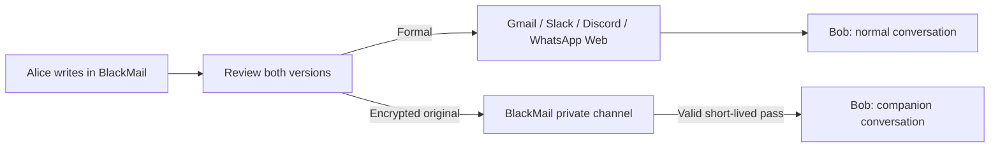

# BlackMail

**One message. Two voices.** [Try the app](https://blackmail-eai-2026.vercel.app)

Write naturally. Send an approved formal version through your usual app; share the original separately through a short-lived BlackMail pass.

**Messages:** real signup/login, username contacts, and formal inbox delivery. [Setup and security checks](docs/supabase.md). This delivers inside BlackMail; external-app integration remains separate.

## Try the demo

- **Messenger:** a chat UI (black + Signal-blue) with a contacts sidebar — direct threads with Bob and Maya plus a **group chat** (Launch Week). Write naturally, **Polish** with AI (or edit), review the formal version, and **Seal & send**.
- Flip the sliding **Formal / Original** toggle to reveal the real voice behind each message, with a live auto-lock countdown. Switch identity (⇄) to read a thread as the recipient. **Revoke** removes the original; the formal record stays.
- Sending creates a **real encrypted vault pass** (it also appears under *Your passes*); **Original** fetches the ciphertext back from the vault and decrypts it in the browser; **Revoke** deletes the vault record. If the server is offline the chat falls back to a local simulation so the UI still demonstrates.

Identity-switch and the seeded sample messages are a single-browser simulation; encryption, storage, five-minute expiry, and revocation are the real backend. AI polishing calls Nebius. Group messages use one shared pass (bearer model: anyone holding the pass can open it).

Also available as separate workspaces: **Compose** (two-column original/formal + create pass), **Open a pass**, and **Your passes**. Branding and a logo-generation prompt live in `branding/` (`extension/logo.svg` is the starter mark).

## Ideal setup



Target: an extension companion panel aligned with the platform thread and recipient-bound private passes. This branch adds real BlackMail accounts, contacts, and formal replies. External messaging platforms still use copy/paste. Browser extensions target web apps, not native mobile apps.

## Run locally

Node.js 22+; run `npm ci` for TypeScript build/test tools. No browser runtime dependencies.

```powershell
npm start
npm test
```

Open http://127.0.0.1:8787. For local AI, copy `.env.example` to `.env` and add `NEBIUS_API_KEY`. Never commit `.env`.

**One composer:** connected sends a Nebius-reviewed formal version plus the P2P original; disconnected sends formal only. Connect through **Informal setup**. Both peers must stay online for originals. [Setup, tests and limits](docs/p2p.md).

**Extension:** Chrome/Edge → Extensions → Developer mode → Load unpacked → select `extension/`. The extension points to the production API. For another backend, update `extension/config.js` and the matching origin permissions in `extension/manifest.json`.

## Hosting

Vercel builds with `npm run build`; `vercel.json` configures static assets and the API. GitHub `main` pushes trigger deployment.

| Server environment variable | Purpose |
| --- | --- |
| `NEBIUS_API_KEY` | AI rewriting; store as a Vercel Secret |
| `NEBIUS_MODEL` | Optional; defaults to `deepseek-ai/DeepSeek-V4-Flash-0731` |
| `KV_REST_API_URL`, `KV_REST_API_TOKEN` | Hosted Redis vault; `UPSTASH_REDIS_REST_URL` / `UPSTASH_REDIS_REST_TOKEN` also accepted |
| `APP_ORIGIN` | Optional exact custom origin; Vercel deployment/production URLs allowed automatically |

Redeploy after changing variables. `/api/health` should show `ok: true`, `storage: "shared"`, and `aiEnabled: true` when configured. Local mode uses memory; hosting requires Redis.

## Privacy and limits

- Real originals: browser AES-256-GCM encryption; decryption key stays in the recipient pass. Vault stores ciphertext and hashed access/revocation capabilities. Redis TTL is five minutes.
- Anyone holding a valid MVP pass can open it. Expiry/revocation blocks future retrieval, not screenshots, copies, or previously read text. No account binding yet.
- Formal text persists wherever you send it, subject to that platform's rules. Revoking an original does not delete the formal copy.
- Sender history stores formal text and revocation controls locally, without original text or recipient keys. AI polishing sends your draft to Nebius.
- Prototype, not security-audited. Demo chat is a simulation; use Compose for actual encrypted passes.
