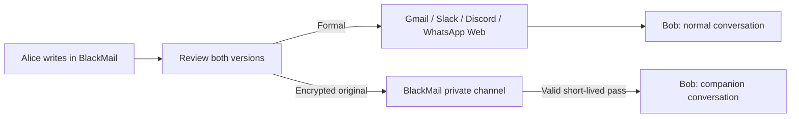

# BlackMail

**One message. Two voices.** [Try the app](https://blackmail-eai-2026.vercel.app)

Write naturally. Send an approved formal version through your usual app; share the original separately through a short-lived BlackMail pass.

**`supabase-messaging` branch:** real signup/login, username contacts, and formal inbox delivery. [Setup and security checks](docs/supabase.md). This delivers inside BlackMail; external-app integration remains separate.

## Try the demo

- **Chat demo:** Alice chats with Bob or Maya. Switch Alice/Bob perspectives and **Normal / BlackMail** views.
- Write a message, polish with AI (or edit manually), review, and send. Share its demo pass, then switch to the recipient.
- Revoke the original: the formal record stays. **Reset demo** starts over.

Contacts, chat delivery, and passes in Chat demo are an **in-memory simulation**, cleared on reload. AI polishing calls Nebius. No real messages are sent.

For real encrypted passes: **Compose** → approve both versions → copy/send formal text through another app → create/share the five-minute pass → recipient uses **Open a pass**. Revoke via **Your passes**.

## Ideal setup



Target: an extension companion panel aligned with the platform thread, bidirectional replies, authenticated contacts, and recipient-bound passes. Current MVP uses copy/paste; there are no direct platform integrations or real chat accounts. Browser extensions target web apps, not native mobile apps.

## Run locally

Node.js 22+; no npm dependencies.

```powershell
npm start
npm test
```

Open http://127.0.0.1:8787. For local AI, copy `.env.example` to `.env` and add `NEBIUS_API_KEY`. Never commit `.env`.

**Extension:** Chrome/Edge → Extensions → Developer mode → Load unpacked → select `extension/`. It points to the hosted API. For another backend, update `extension/config.js` and the matching origin permissions in `extension/manifest.json`.

## Hosting

Vercel builds with `npm run build`; `vercel.json` configures static assets and the API. GitHub `main` pushes trigger deployment.

| Server environment variable | Purpose |
| --- | --- |
| `NEBIUS_API_KEY` | AI rewriting; store as a Vercel Secret |
| `NEBIUS_MODEL` | Optional; defaults to `deepseek-ai/DeepSeek-V4-Flash-0731` |
| `KV_REST_API_URL`, `KV_REST_API_TOKEN` | Hosted Redis vault; `UPSTASH_REDIS_REST_URL` / `UPSTASH_REDIS_REST_TOKEN` also accepted |
| `APP_ORIGIN` | Optional exact custom origin; Vercel deployment/production URLs allowed automatically |

Redeploy after changing variables. `/api/health` should show `ok: true`, `storage: "shared"`, and `aiEnabled: true` when configured. Local mode uses memory; hosting requires Redis.

## Privacy and limits

- Real originals: browser AES-256-GCM encryption; decryption key stays in the recipient pass. Vault stores ciphertext and hashed access/revocation capabilities. Redis TTL is five minutes.
- Anyone holding a valid MVP pass can open it. Expiry/revocation blocks future retrieval, not screenshots, copies, or previously read text. No account binding yet.
- Formal text persists wherever you send it, subject to that platform's rules. Revoking an original does not delete the formal copy.
- Sender history stores formal text and revocation controls locally, without original text or recipient keys. AI polishing sends your draft to Nebius.
- Prototype, not security-audited. Demo chat is a simulation; use Compose for actual encrypted passes.
