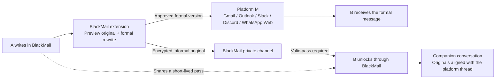

# BlackMail

One message. Two voices. Browser-extension MVP with local and Vercel hosting modes.

## Ideal setup: one conversation, two channels

Based on the product sketch: A writes naturally in BlackMail. B receives an approved formal version through the existing messaging platform, and can optionally open the original through BlackMail. Gmail is one example; the same design targets Outlook, Slack, Discord, and WhatsApp Web.



The intended experience is two conversations side by side: the normal platform thread keeps the formal record, while an extension-owned companion panel shows the informal originals for that same thread. B can reply through the same flow, reversing the sender and recipient roles. Compose once; review both versions; deliver each through its own channel.

- **Normal platform:** receives only the approved formal text. The original and its unlock key are not embedded in the formal message or hidden inside the platform's page.
- **BlackMail:** holds encrypted originals, unlocked separately through a short-lived pass from the sender. The current five-minute pass expires after creation; automatic key rotation and recipient-bound access are future work.
- **Expiry / revocation / deletion:** removes future access to the informal original without issuing a delete request for the formal message on the other platform. The formal record remains subject to that platform's own retention and deletion rules.
- **Trust boundary:** anyone with a current MVP pass can use it. Future account-bound connections should restrict access to the intended recipient. Neither design can recall screenshots, copied text, or an original already read.

The goal is control over future access to your casual voice while keeping a usable formal record. This does not make BlackMail categorically more secure than established messengers, and a formal rewrite cannot reconstruct the exact original.

| Capability | Current MVP | Ideal setup |
| --- | --- | --- |
| Compose original + approve formal rewrite | Implemented; AI optional | Available inside the messaging workflow |
| Deliver formal message | User copies/pastes and sends | Platform-specific send integration after approval |
| Open informal original | Paste a five-minute pass into BlackMail | Companion panel aligned with the platform thread |
| Recipient access | Bearer pass; no accounts | Authenticated, recipient-bound connection + short-lived authorization |
| Replies and thread matching | Independent message passes | Bidirectional companion conversation linked to the formal thread |
| Revoke informal access | Implemented | Same behavior across supported integrations |

Browser extensions target the web versions of these platforms. Each integration needs its own implementation; native mobile apps are outside this extension's scope.

## Run

Node.js 22+; no npm dependencies.

```powershell
npm start
```

Open http://127.0.0.1:8787 for the standalone demo.

For the Chrome/Edge extension:

1. Open `chrome://extensions` or `edge://extensions`.
2. Enable Developer mode → Load unpacked → select this repo's `extension` folder.
3. Click BlackMail in the browser toolbar. It opens the composer in a new tab.
4. Extension points to `https://blackmail-eai-2026.vercel.app`. For local-only extension use, change `EXTENSION_API` in `extension/config.js` to `http://127.0.0.1:8787` and replace both hosted origins in `extension/manifest.json` with that local origin, then reload the extension and keep the local Node server running. The standalone localhost web demo always uses the local backend.

Optional AI: copy `.env.example` to `.env`, add your Nebius key, restart the server. Without a key, edit both versions manually. Provider/model availability depends on your Nebius account. Your key stays server-side. Clicking **Polish with AI** sends the original draft to that provider.

## Demo flow

1. A writes the original and approves/edits the formal version.
2. **Copy formal** → paste and send through Gmail, Outlook, Slack, Discord, etc.
3. **Create private pass** → share the `bm1...` pass separately with B.
4. B opens BlackMail → **Open a pass** → paste → unlock.
5. A opens **Your passes** → **Revoke original**. The formal message on the other platform stays intact.

For the local demo, both browser profiles must use the same running server on this computer. The hosted web app uses shared Redis storage and supports recipients on different computers. **Preview recipient view** demonstrates the flow in one tab. No third-party messaging app is accessed and no messages are sent automatically.

## Access model

- Each pass expires five minutes after creation, enforced by the server. This is a per-message pass, not a rotating shared password; no automatic renewal.
- Browser encrypts originals with AES-256-GCM and a fresh random key/IV. Vault stores ciphertext, a hashed retrieval capability, and a separate hashed revocation capability: in memory locally, or Redis when hosted. Decryption key never goes to the vault API.
- Pass includes message ID, retrieval capability, and decryption key. Anyone holding the complete pass can open it until expiry/revocation. No account binding or mutual-connection verification yet. Share it through a channel you trust.
- Sender history stores formal text and the revocation capability in that browser's local storage. It does not store originals, recipient passes, or encryption keys. Clearing browser data loses revocation controls; five-minute expiry still applies.
- Local expired records are purged on vault operations; Redis records have a five-minute TTL. Revocation deletes the record immediately. Restarting the local memory server loses originals; hosted records survive function restarts until expiry/revocation. Browser history remains.
- Recipient UI clears plaintext on expiry, tab hiding, or closing. While visible it checks server access every three seconds. Revocation cannot recall plaintext already downloaded, screenshots, copies, or modified clients. This is time-limited access, not screenshot prevention or a claim of stronger security than established messengers.
- Only encrypted originals are sent to the vault. Optional AI rewriting separately exposes the draft to the configured provider. Formal text is intentionally persistent wherever the sender sends it; BlackMail cannot guarantee another platform's retention behavior.

## Validation

```powershell
npm test
```

Covers encryption/decryption, wrong keys, server-enforced expiry, revoke authorization, blocked origins, malformed requests, and static-file isolation.

## MVP boundaries

No accounts, authenticated recipients, direct platform integrations, or production security audit. Copy/paste works across platforms; native-app extensions are not included. Local mode uses memory; Vercel mode requires shared Redis storage and fails closed without it. Recipient binding and identity remain future work.

The original `src/nebius_start_building.py` starter is preserved. Extension and local server use Node.js instead.

## Vercel hosting

1. Push these changes to your GitHub repo; import the repo into Vercel.
2. Framework preset: **Other**. `vercel.json` supplies build command (`npm run build`), output directory (`public`), and API routing. Node.js 22+.
3. Connect an Upstash Redis database (via Vercel Marketplace or your existing Upstash account). Set server-side environment variables `UPSTASH_REDIS_REST_URL` and `UPSTASH_REDIS_REST_TOKEN` in the Vercel project. Use REST credentials, not a `redis://` connection string. Do not put secrets in frontend config or source control.
4. Optional: set `NEBIUS_API_KEY` and `NEBIUS_MODEL` for rewriting. Without these, users edit both versions manually.
5. Set `APP_ORIGIN` to the exact production origin (e.g. `https://your-project.vercel.app`), then deploy/redeploy. Vercel's automatic deployment and production URLs are also allowed.
6. Check `/api/health`: expect `"ok":true` and `"storage":"shared"`. Test creating a pass in one browser, unlocking in another, and revoking. A rendered homepage alone does not verify backend configuration.

Hosted web client automatically calls its own origin. The unpacked extension is configured for `https://blackmail-eai-2026.vercel.app`. To use another deployment, change `EXTENSION_API` in `extension/config.js`, `host_permissions`, and CSP `connect-src` in `extension/manifest.json` to that exact HTTPS origin, then reload the extension. Vercel Marketplace's `KV_REST_API_URL` / `KV_REST_API_TOKEN` variables are also accepted in place of the Upstash variable names.

Redis stores ciphertext and hashed capabilities with a five-minute TTL. Expiry and revocation work across function instances. Shared per-IP rate limiting uses Redis too. Local storage still retains sender history; deleting cloud originals does not remove formal messages sent on other platforms. Storage-provider backup/retention policies also apply; this is not a guarantee of physical erasure from provider backups.

`npm test` includes mocked Redis adapter/TTL and missing-hosted-storage tests. Live Vercel routing, actual Redis Lua execution, and provider credentials must be verified after provisioning. No deployment is created merely by adding these files.
